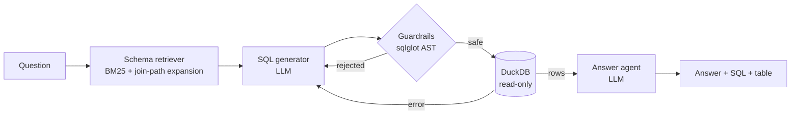

# QueryPilot

**A multi-agent text-to-SQL analytics copilot.** Ask a business question in plain English, for example
"Which state generated the most revenue?" QueryPilot finds the relevant tables, writes DuckDB SQL, checks it
with AST-level guardrails, runs it read-only, fixes its own errors, and explains the result.

   



## Features

- **LangGraph agent pipeline**: retrieve → generate → validate → execute → self-repair → answer. Up to 3 repair
  attempts, each seeing the exact parser, guardrail or DuckDB error. Repairs widen to the full schema when a table
  or column is missing.
- **Schema retrieval**: BM25 over table and column descriptions, with automatic bridge tables, so only the
  relevant schema goes into the prompt.
- **Defense-in-depth guardrails**:
  - sqlglot AST checks: a single read-only statement, a table allow-list, and no DDL, DML, `ATTACH`, `COPY`,
    `PRAGMA`, file or network table functions, or system catalogs.
  - An automatic `LIMIT`.
  - A DuckDB connection opened `read_only` with `enable_external_access=false`, plus a query timeout.
- **Three ways to use it**: a FastAPI service, an **MCP server** (for Claude Desktop, Cursor, and other
  assistants), and a Streamlit UI.
- **Evaluation harness**:
  - A 100-question benchmark (33 easy, 38 medium, 29 hard) with gold SQL, scored by execution match.
  - A 60-case red-team suite.
  - CI on GitHub Actions.
- **Choice of LLM provider**: OpenAI, Anthropic or AWS Bedrock, selected with one environment variable.

## Results

### Offline (deterministic, no API key needed): `make eval-offline`

| Metric | Result |
|---|---|
| Destructive or injection SQL blocked | **60 / 60 (100%)** across 7 attack categories |
| False positives on valid gold queries | **0 / 100** |
| Schema retrieval table recall | **99.1%** (all gold tables retrieved for 97% of questions) |
| Generator prompt size, retrieved vs. full schema | **838 → 411 tokens (~51% smaller)** |
| Test suite | 31 tests, 93% line coverage |

### End-to-end with an LLM: `make eval`

`eval/run_eval.py` reports execution accuracy overall and by difficulty, first-pass accuracy, the self-repair
recovery rate, p50/p95 latency and tokens per query. It also runs an ablation without retrieval
(`make eval-ablation`). Results are written to `results/llm.json`.

| Model | Exec. accuracy | First pass | Repair recovery | p95 latency |
|---|---|---|---|---|
| _run `make eval` and fill in_ | | | | |

> Notes: the warehouse is synthetic but seeded, so results are reproducible. The benchmark is in-domain, and the
> retrieval synonyms were developed against it, so treat retrieval recall as a development-set number. Token counts
> use `tiktoken` when available and fall back to chars/4.

## Quickstart

```bash
git clone https://github.com/mnukala2/querypilot && cd querypilot
python -m venv .venv && source .venv/bin/activate
make install            # pip install -r requirements-dev.txt
make data               # builds data/warehouse.duckdb (8 tables, ~60k rows)
make test               # 31 tests, no API key needed
make eval-offline       # guardrail / retrieval / prompt-size metrics

cp .env.example .env    # add OPENAI_API_KEY (or ANTHROPIC_API_KEY / AWS creds)
make api                # http://localhost:8000/docs
make ui                 # Streamlit at http://localhost:8501
make eval               # full LLM benchmark
```

```bash
curl -s -X POST localhost:8000/ask -H 'content-type: application/json' \
  -d '{"question": "What is total revenue by product category?"}' | jq
```

### Use it from Claude Desktop or any other MCP client

```json
{
  "mcpServers": {
    "querypilot": { "command": "python", "args": ["-m", "querypilot.mcp_server"], "cwd": "/path/to/querypilot" }
  }
}
```

Tools: `list_tables`, `describe_table`, `run_sql` (guarded), `ask` (full pipeline).

## The data

The data is a seeded e-commerce warehouse from 2024 to 2025. Revenue is `quantity * unit_price * (1 - discount)`.

| Table | Rows | What it holds |
|---|---|---|
| customers | 2,000 | location, segment, signup date |
| orders | 12,000 | date, status, channel |
| order_items | 20,847 | product, quantity, price, discount |
| products / categories | 96 / 8 | price, cost, launch date |
| payments | 10,539 | method, amount |
| shipments | 9,000 | carrier, ship and delivery dates |
| reviews | 6,000 | 1–5 star ratings |

## Project layout

```
querypilot/
  graph.py        LangGraph state machine (agents + routing)
  retrieval.py    BM25 schema retriever with join-path expansion
  guardrails.py   sqlglot AST validator
  executor.py     read-only DuckDB executor with timeout
  schema.py       table/column catalog and prompt rendering
  api.py          FastAPI service       mcp_server.py   MCP server       ui.py   Streamlit
eval/
  benchmark.jsonl 100 questions + gold SQL      redteam.jsonl   60 attacks
  run_eval.py     LLM benchmark                 offline_eval.py deterministic metrics
tests/            pytest suite (fake LLM, no network)
```

## Design decisions

- **Why AST guardrails instead of regex?** Regex misses things like `DR/**/OP`, stacked statements and table
  functions hidden inside subqueries. Parsing to an AST checks what the database will actually execute.
- **Why retrieval for only 8 tables?** It shrinks every prompt by about half today, and the same approach scales
  to warehouses with hundreds of tables, where sending the full schema stops working.
- **Why execution match?** Different SQL can return the same correct answer. Comparing result sets
  (order-insensitive, rounded) measures whether the user got the right answer.

## License

MIT © Malaika Nukala
